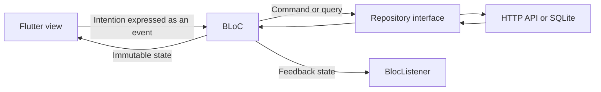

# Architecture and learning guide

Catfolio is a small Android application built to make production patterns easy to inspect. All product copy, comments, tests, and documentation are in English. This is a worked example with explicit tradeoffs, not a claim that one architecture fits every team.

## 1. Follow the unidirectional flow

MVI means Model, View, Intent. Here the Model is the immutable UI state, the View is a widget tree, and an Intent is a typed BLoC event. BLoC implements the state transition logic. MVI and BLoC are compatible ideas, but BLoC is not an official MVI framework and does not require a separate reducer class.

An asynchronous handler performs work through a repository and emits the result. Rendering is a function of state. Transient feedback is handled by `BlocListener`, not inside a builder. A tab index, focus, and an unsaved text draft are local widget state; they do not need a business BLoC.

## 2. Read the code in this order

1. [CatFact](../lib/features/facts/domain/cat_fact.dart): an immutable domain value with a stable identity.
2. [FactsRepository](../lib/features/facts/domain/facts_repository.dart): the contract available to business logic.
3. [CatFactApi](../lib/features/facts/data/cat_fact_api.dart): HTTPS requests, timeouts, and boundary validation.
4. [FactsEvent](../lib/features/facts/presentation/bloc/facts_event.dart), [FactsState](../lib/features/facts/presentation/bloc/facts_state.dart), and [FactsBloc](../lib/features/facts/presentation/bloc/facts_bloc.dart): the MVI loop.
5. [FactsPageView](../lib/features/facts/presentation/facts_page.dart): intention dispatch and rendering.
6. [FavoritesRepository](../lib/features/favorites/domain/favorites_repository.dart) and [SqliteFavoritesRepository](../lib/features/favorites/data/sqlite_favorites_repository.dart): persistent CRUD.
7. [FavoritesBloc](../lib/features/favorites/presentation/bloc/favorites_bloc.dart): write ordering, readback, and error recovery.
8. [CatfolioApp](../lib/app/catfolio_app.dart) and [bootstrap](../lib/main.dart): composition and resource ownership.
9. [Tests](../test): independently verified behavior, including real SQLite reopen tests.

## 3. Boundaries and dependencies

The layout is feature-first. Each feature contains `domain`, `data`, and `presentation` folders. Domain types and contracts do not import Flutter, HTTP, or SQLite. The facts domain uses Equatable and crypto, which are plain Dart packages.

Presentation depends on domain contracts. Data implements those contracts. The composition root is the only place that connects concrete implementations. Constructor injection makes a BLoC testable without a widget tree or service locator. Repositories are registered with `RepositoryProvider`; BLoCs are created and disposed by `BlocProvider`. Providers sit above `MaterialApp`, so pushed detail routes share the same collection state.

Favorites deliberately depend on the facts domain model. The features are related; extracting that single value into another package would add indirection without improving this application. No BLoC depends on another BLoC. A single app-scoped FavoritesBloc keeps bookmarks, list contents, and detail notes consistent.

## 4. A save, step by step

1. A user taps a bookmark. The widget dispatches `FavoriteAdded(fact)`.
2. FavoritesBloc emits `isSaving: true`. The UI disables mutation controls.
3. The repository commits the SQLite insert. Existing IDs use `IGNORE`, preserving any note.
4. The BLoC reads the committed collection and emits an immutable snapshot.
5. `BlocSelector` updates the bookmark only when its selected values change.
6. `BlocListener` observes a new `feedbackId` and displays a notification once.

The update and delete paths use the same sequence. A failed write keeps the last published collection and reports a safe error. If a write commits but the subsequent read fails, the UI retains its previous snapshot; retrying is safe because adding an existing fact is idempotent. The note editor stays open on failure and keeps the user's draft.

## 5. Concurrency is part of correctness

`FactsBloc` registers **one base event handler** with `droppable()`. A second refresh or pagination request is ignored while the current request is running. This is an intentional simple UX: overlapping taps do not start competing requests, and the refresh control is disabled while busy. A timeout stops waiting for the response; it does not claim to cancel the underlying HTTP connection.

`FavoritesBloc` registers **one base event handler** with `sequential()`. Reads, writes, and search intentions preserve arrival order. Registering a separate sequential handler for each event subtype would not serialize different subtypes. A queued remove must not overtake an unfinished add. Search can wait behind a short local write; debounce is unnecessary for this in-memory filter.

For live search against a remote API, consider a debounced `restartable()` pipeline, transport cancellation, and tests proving that old results cannot replace newer results. Do not apply transformers mechanically.

## 6. State modeling

States use Equatable and unmodifiable lists. Equality suppresses unnecessary duplicate emissions. Nullable failure and feedback fields are cleared on the next operation. `FavoritesState.copyWith` intentionally clears these transient fields when omitted; other fields are retained. `FactsState` is reconstructed explicitly to keep pagination resets visible.

Loading an empty feed differs from refreshing an existing feed. A refresh or pagination failure preserves existing facts. Pagination retries the same page and deduplicates facts by stable identity. Empty and terminal-page states have explicit UI.

Transient notifications use state plus a monotonically increasing ID. This keeps the example inspectable and testable. A dedicated effect stream is another valid team convention, but adds lifecycle and replay rules. Critical navigation or business outcomes should not depend only on a transient snackbar.

## 7. Persistence and identity

The API supplies fact text without IDs. A SHA-256 digest of normalized lowercase text is stable across launches. `hashCode` is not a persistent identifier. The remote text is retained as a snapshot: favorites remain readable when the network is unavailable or the API changes.

SQLite schema version 1 stores the fact ID, text, note, and UTC creation timestamp. Queries use bound parameters. Note length is validated in the form and repository and constrained in the schema. A blank note is allowed. Deleting a favorite also deletes its note. Future schema changes require a version increment and an explicit `onUpgrade` migration with migration tests; never drop user data to solve a migration problem.

The database contains personal notes in application storage, without application-level encryption. No account, backend sync, or analytics is implemented. OS backup rules may apply. The repository is designed for one app-scoped BLoC writer; multiple processes or independent writers would require a change-notification strategy.

## 8. Errors, lifecycle, and logging

HTTP status errors, client failures, timeouts, and invalid JSON become typed `AppFailure` values. Widgets never parse transport exceptions. SQLite errors become storage failures. Unexpected errors are reported through the BLoC observer and replaced with safe UI messages.

The observer logs event and state types in debug mode, without note contents or full state dumps. It is an educational observer, not production crash reporting. The bootstrap owns and closes the HTTP client and database. Startup database failure offers retry rather than a blank screen. Process termination relies on the OS to release handles; each completed SQLite statement is committed independently.

## 9. Test strategy

- API tests use `MockClient` to verify requests, response validation, error mapping, and page boundaries.
- BLoC tests verify emitted states, retry behavior, deduplication, and competing intentions.
- SQLite tests use the actual schema on a temporary disk database through FFI. Closing and reopening proves persistence independently of the UI fake.
- Widget tests exercise the full favorites workflow and retention of a note draft after a failed write.
- The Android integration test uses the native SQLite plugin with deterministic fact fixtures. It is independent of public API uptime.

A native integration pass does not prove physical-device behavior, iOS compatibility, production signing, or store readiness. A separate live API smoke check verifies the external service at a point in time.

## 10. Deliberate scope choices

- Two BLoCs, not a global mutable application store.
- Repository interfaces, without a pass-through use-case class per operation.
- Handwritten immutable state, without generated Freezed code obscuring the first learning pass.
- Navigator routes for two related screens; a routing package becomes useful with deep links and complex navigation.
- Explicit load-more pagination instead of a scroll listener with hidden request triggers.
- Local favorites work offline. The discovery feed is not cached across process restarts. Removal requires confirmation, including from a bookmark button.
- Android is the primary target. The included web scaffold does not provide a browser SQLite implementation.

## 11. Practice tasks

1. Add a favorites sort intention, write its BLoC test, then expose a sort menu.
2. Add a character-count filter without modifying the data layer.
3. Introduce a version 2 database migration for a user tag, preserving existing notes.
4. Add a random fact endpoint, including malformed-response and concurrency tests.
5. Add a repository feed cache and distinguish cached results from a fresh network response.

## References

- [Official BLoC architecture](https://bloclibrary.dev/architecture/)
- [Flutter BLoC widgets and lifecycle](https://bloclibrary.dev/flutter-bloc-concepts/)
- [BLoC event transformers](https://pub.dev/packages/bloc_concurrency)
- [BLoC testing](https://pub.dev/packages/bloc_test)
- [Flutter architecture recommendations](https://docs.flutter.dev/app-architecture/recommendations)
- [SQLite plugin](https://pub.dev/packages/sqflite)
- [Cat Fact Ninja](https://catfact.ninja)
